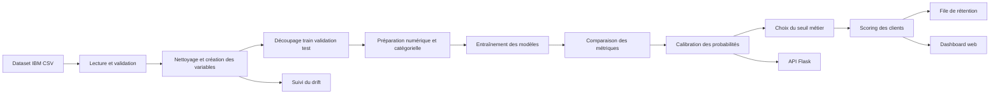
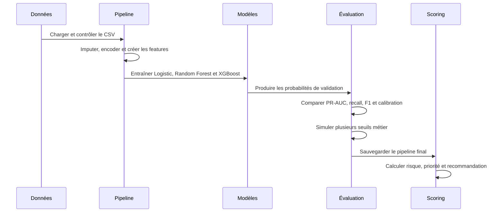
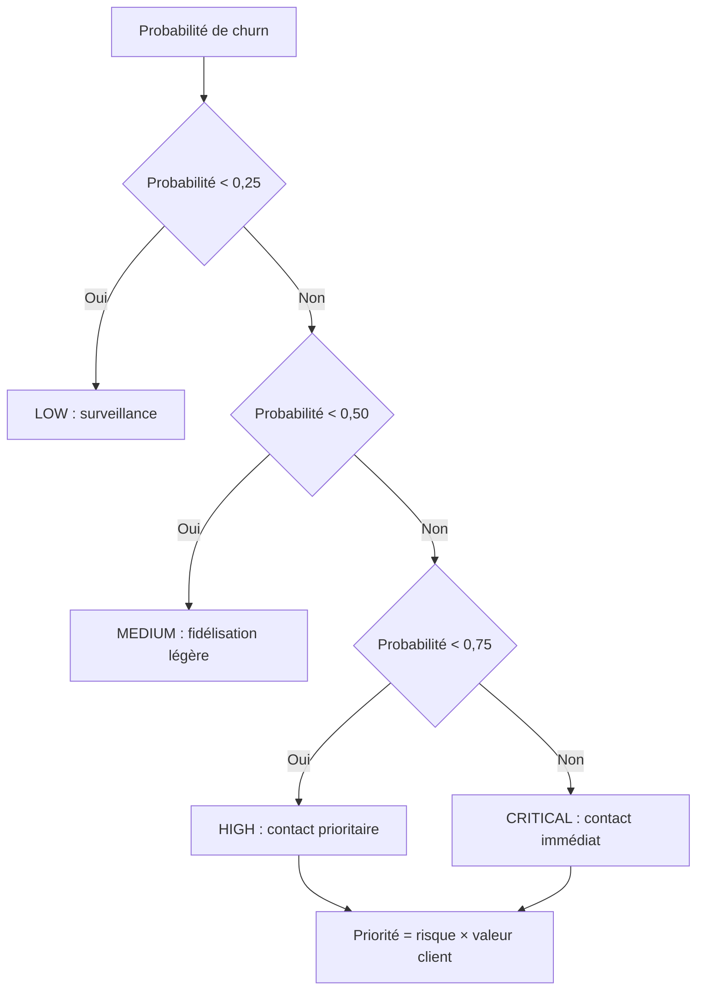
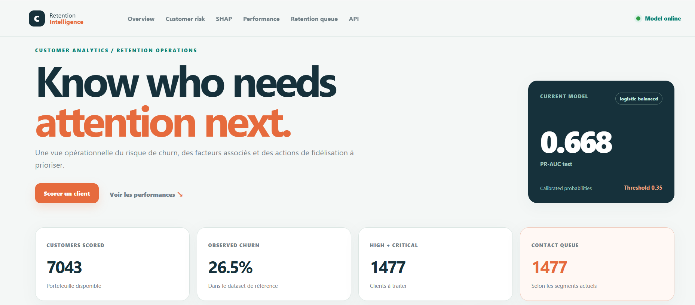
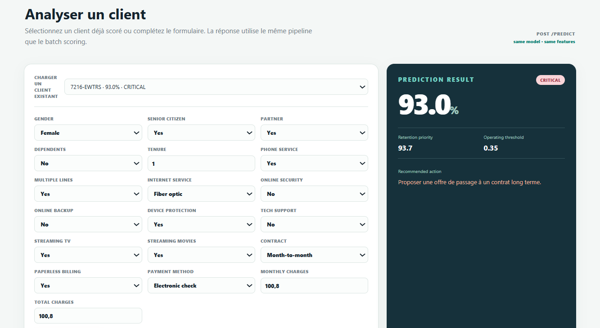
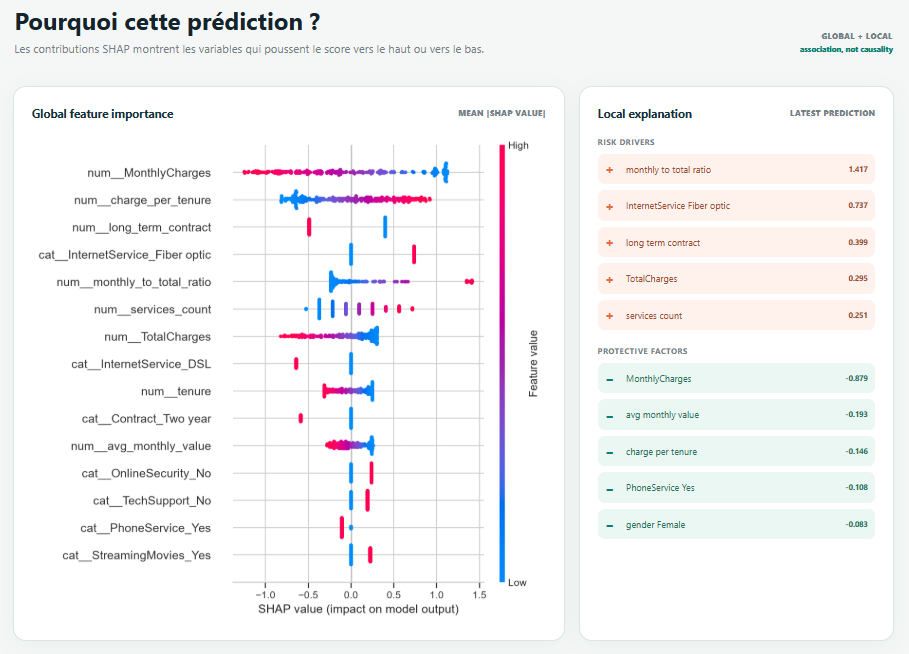
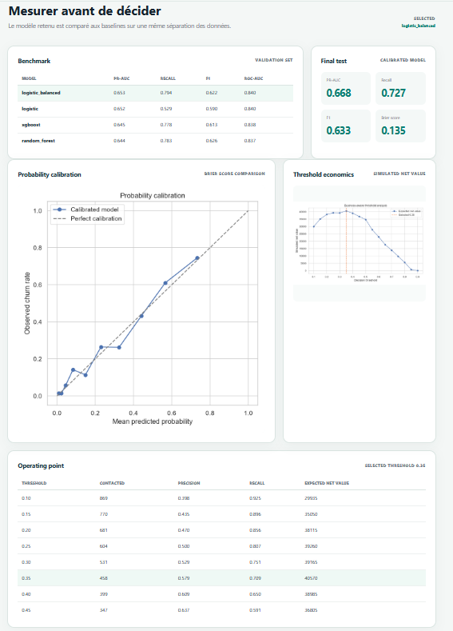
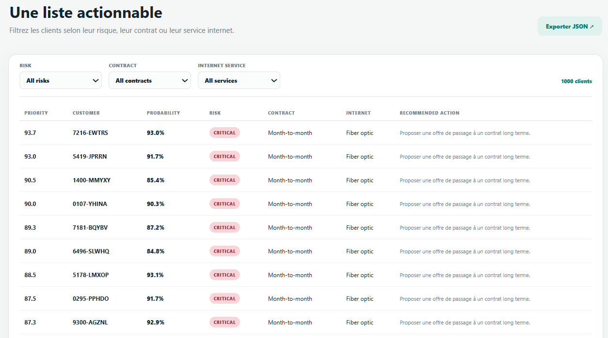

# Customer Churn Prediction & Retention Intelligence Platform

Application locale de prédiction du churn et de priorisation des actions de fidélisation pour une entreprise de télécommunications.

Le projet part du dataset public IBM Telco Customer Churn, prépare les données, compare plusieurs modèles, calibre les probabilités, choisit un seuil de décision lié à une capacité de contact, explique les prédictions et expose le résultat dans une API Flask accompagnée d’une interface web.

## 1. Aperçu rapide

| Élément | Valeur |
|---|---|
| Dataset | IBM Telco Customer Churn |
| Nombre de clients | 7 043 |
| Taux de churn observé | 26,54 % |
| Modèle retenu | Logistic Regression équilibrée |
| Seuil de décision | 0,35 |
| PR-AUC sur le test | 0,668 |
| Recall sur le test | 0,727 |

Les résultats sont ceux du dernier entraînement local. Ils sont enregistrés dans `results/metrics/` et peuvent être régénérés à tout moment.

## 2. Fonctionnement de l’application

Le système répond à quatre questions simples :

1. Quels clients présentent le risque le plus élevé ?
2. Quelle est la probabilité de churn pour un client donné ?
3. Quelles variables ont le plus influencé la prédiction ?
4. Quelle action de fidélisation peut être proposée en priorité ?

### Schéma général



### Déroulement d’un entraînement



## 3. Dataset

La source utilisée est le dépôt public [IBM Telco Customer Churn](https://github.com/IBM/telco-customer-churn-on-icp4d). Le fichier attendu est :

```text
data/raw/Telco-Customer-Churn.csv
```

Le fichier brut n’est pas versionné. Pour le récupérer :

```powershell
.venv\Scripts\python.exe scripts\download_data.py
```

Le contrôle initial vérifie notamment :

- la présence de la cible `Churn` ;
- l’absence d’identifiants clients dupliqués ;
- les valeurs négatives de `tenure`, `MonthlyCharges` et `TotalCharges` ;
- les valeurs manquantes ;
- la cohérence du type de la cible.

Le profil produit par le dernier run se trouve dans :

```text
results/reports/data_profile.json
results/reports/data_validation.md
```

## 4. Variables utilisées

Les colonnes originales décrivent le profil du client, son contrat, ses services et ses charges. Des variables complémentaires sont calculées à partir de ces informations :

| Variable | Description |
|---|---|
| `services_count` | Nombre de services actifs |
| `support_services_count` | Nombre de services liés au support et à la protection |
| `has_security_bundle` | Présence simultanée de plusieurs protections |
| `long_term_contract` | Contrat d’un an ou de deux ans |
| `auto_payment` | Paiement automatique |
| `tenure_bucket` | Groupe d’ancienneté du client |
| `avg_monthly_value` | Valeur totale rapportée à l’ancienneté |
| `charge_per_tenure` | Charges cumulées rapportées à l’ancienneté |
| `monthly_to_total_ratio` | Ratio entre charges mensuelles et cumulées |

`customerID` n’est jamais utilisé comme variable de prédiction. La cible `Churn` est retirée avant la construction des features.

## 5. Modèles et résultats

Le benchmark est réalisé sur le même découpage stratifié pour tous les modèles.

| Modèle | Precision | Recall | F1 | ROC-AUC | PR-AUC |
|---|---:|---:|---:|---:|---:|
| Logistic Regression équilibrée | 0,511 | 0,794 | 0,622 | 0,840 | 0,653 |
| Logistic Regression | 0,667 | 0,529 | 0,590 | 0,840 | 0,652 |
| XGBoost | 0,506 | 0,778 | 0,613 | 0,838 | 0,645 |
| Random Forest | 0,521 | 0,783 | 0,626 | 0,837 | 0,644 |

La régression logistique équilibrée a été retenue car elle obtient le meilleur PR-AUC de validation. XGBoost est bien comparé, mais il n’est pas choisi uniquement parce qu’il est plus complexe.

### Résultat final sur le test

| Métrique | Valeur |
|---|---:|
| Accuracy | 0,776 |
| Precision | 0,560 |
| Recall | 0,727 |
| F1 | 0,633 |
| ROC-AUC | 0,848 |
| PR-AUC | 0,668 |
| Brier score | 0,135 |

Fichiers correspondants :

```text
results/metrics/model_benchmark.csv
results/metrics/final_test_metrics.json
results/metrics/threshold_analysis.csv
results/metrics/business_threshold_table.csv
```

## 6. Choix du seuil métier

Le seuil `0,50` n’est pas imposé par défaut. Plusieurs seuils sont comparés avec :

- le nombre de clients contactés ;
- la precision et le recall ;
- les faux positifs et faux négatifs ;
- le coût d’une offre et d’un contact ;
- la perte évitée estimée ;
- la valeur nette simulée.

Avec les hypothèses de `configs/business.yaml`, le seuil retenu est `0,35`. La valeur nette calculée est une simulation destinée à illustrer la décision ; elle ne représente pas les comptes réels d’une entreprise.



## 7. Lancer le projet en local

### Installation

Dans PowerShell :

```powershell
cd "C:\Users\Probook\Documents\ChatGPT\Customer Churn Prediction & Retention Intelligence Platform"

py -3.12 -m venv .venv
.venv\Scripts\python.exe -m pip install -r requirements.txt
```

Si Python est déjà installé mais que `py -3.12` n’est pas disponible, utilisez Python 3.11 ou supérieur et remplacez la première commande par :

```powershell
python -m venv .venv
```

### Refaire le traitement complet

```powershell
.venv\Scripts\python.exe scripts\download_data.py
.venv\Scripts\python.exe scripts\prepare_data.py
.venv\Scripts\python.exe scripts\run_pipeline.py
```

Cette commande recrée les fichiers de train, validation et test, entraîne les modèles, génère les graphiques, sauvegarde le modèle et produit les scores clients.

### Démarrer l’interface web

```powershell
$env:PYTHONPATH = "src"
.venv\Scripts\python.exe -m churn_intelligence.api.app
```

Ouvrir ensuite : [http://127.0.0.1:5000](http://127.0.0.1:5000)

## 8. API Flask

| Méthode | Route | Utilisation |
|---|---|---|
| GET | `/health` | Vérifier que l’application répond |
| GET | `/model/info` | Consulter la version et les métriques |
| POST | `/predict` | Scorer un seul client |
| POST | `/predict/batch` | Scorer plusieurs clients |
| GET | `/metrics` | Lire le benchmark et le résultat final |
| GET | `/api/overview` | Récupérer les indicateurs du dashboard |
| GET | `/api/scores?risk=CRITICAL` | Filtrer la file de rétention |

Exemple de corps JSON pour `/predict` :

```json
{
  "gender": "Female",
  "SeniorCitizen": 0,
  "Partner": "Yes",
  "Dependents": "No",
  "tenure": 8,
  "PhoneService": "Yes",
  "MultipleLines": "No",
  "InternetService": "Fiber optic",
  "OnlineSecurity": "No",
  "OnlineBackup": "No",
  "DeviceProtection": "No",
  "TechSupport": "No",
  "StreamingTV": "Yes",
  "StreamingMovies": "Yes",
  "Contract": "Month-to-month",
  "PaperlessBilling": "Yes",
  "PaymentMethod": "Electronic check",
  "MonthlyCharges": 89.5,
  "TotalCharges": 716.0
}
```

La réponse contient la probabilité, le segment de risque, la priorité, les principaux facteurs de risque, les facteurs protecteurs et une recommandation de fidélisation.

## 9. Démonstration de l’application

Les captures ci-dessous correspondent à l’interface et aux résultats produits localement. Les fichiers sont conservés dans `docs/screenshots/` afin de pouvoir les afficher directement sur GitHub.

### Vue générale

La page d’accueil présente les indicateurs du portefeuille, le modèle utilisé, les clients prioritaires et les principaux facteurs associés au risque.



### Analyse d’un client

Le formulaire permet de sélectionner un client existant ou de saisir ses caractéristiques. Le résultat affiche la probabilité de churn, le niveau de risque, la priorité et l’action recommandée.



### Explication SHAP

Cette vue rassemble l’importance globale des variables et l’explication locale d’une prédiction individuelle.



### Performance du modèle

Le benchmark compare les modèles testés. La page présente également la calibration des probabilités et l’impact du seuil de décision sur la valeur simulée.



### File de rétention

La file de rétention permet de filtrer les clients par niveau de risque, type de contrat et service internet afin de préparer les actions de contact.



La documentation des routes API et les instructions pour reproduire les captures se trouvent dans [`docs/screenshots/README.md`](docs/screenshots/README.md).

## 10. Tests et qualité

```powershell
.venv\Scripts\ruff.exe check src scripts tests
.venv\Scripts\python.exe -m pytest -q
.venv\Scripts\python.exe -m compileall -q src scripts
```

Les tests couvrent la validation des données, la conversion de `TotalCharges`, les features, le choix du seuil, le calcul de priorité et les routes Flask principales.

## 11. Docker

Après avoir créé le modèle avec `scripts\run_pipeline.py` :

```powershell
docker build -t churn-retention-platform .
docker run --rm -p 5000:5000 churn-retention-platform
```

Docker Desktop doit être démarré avant de lancer ces commandes.

## 12. Structure du dépôt

```text
.
├── configs/                 # Paramètres data, features, modèles et business
├── data/raw/                # Dataset public non versionné
├── data/processed/          # Splits générés par le pipeline
├── docs/                    # Rapport, guide d’entretien et captures
├── frontend/                # Template HTML et CSS du dashboard
├── models/                  # Pipeline joblib et métadonnées locales
├── results/                 # Métriques, graphiques, scores et rapports
├── scripts/                 # Commandes d’exécution
├── src/churn_intelligence/  # Code applicatif et modules métier
├── tests/                   # Tests unitaires et API
├── Dockerfile
├── requirements.txt
└── pyproject.toml
```

## 13. Pousser le projet sur GitHub

Les données brutes, l’environnement virtuel et les fichiers lourds du modèle sont exclus par `.gitignore`.

```powershell
git status
git add .
git commit -m "Build customer churn retention platform"
git branch -M main
git remote add origin https://github.com/USERNAME/REPOSITORY.git
git push -u origin main
```

Remplacez `USERNAME/REPOSITORY` par l’adresse de votre dépôt GitHub. Sur une nouvelle machine, il faudra relancer le téléchargement des données puis `scripts\run_pipeline.py`.

## 14. Limites du projet

- Le dataset est historique et public ; il ne représente pas nécessairement une entreprise actuelle.
- Une corrélation observée ne prouve pas la cause du départ d’un client.
- Les explications SHAP décrivent la contribution des variables à la prédiction, pas la raison certaine du churn.
- Les actions de fidélisation sont des règles simples et ne garantissent aucun résultat.
- Les coûts et la valeur client du fichier `configs/business.yaml` sont des hypothèses de simulation.
- Une utilisation en production demanderait des données fraîches, un suivi des performances, une validation métier et une supervision humaine.

## 15. Documents complémentaires

- `docs/EXPERIMENT_REPORT.md` : compte rendu de l’expérience ;
- `docs/INTERVIEW_GUIDE.md` : questions et réponses pour présenter le projet ;
- `docs/CV_PROJECT_SUMMARY.md` : résumé court pour un CV ;
- `docs/screenshots/README.md` : liste des captures à ajouter.

## Auteur
Bouizdouzene Bilal